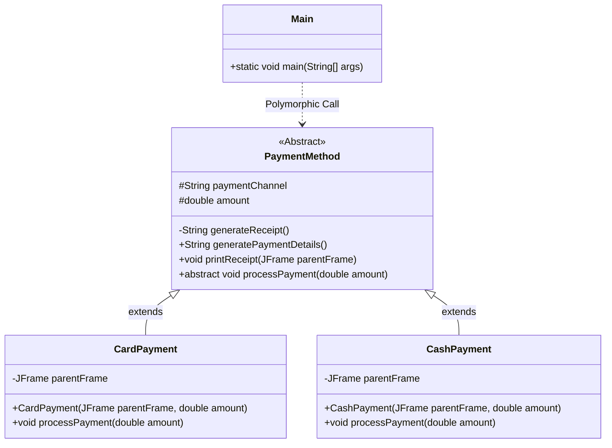

# Payment Processing System (Java Swing GUI)

A desktop GUI application built with Java (Swing) for processing payments with support for Card and Cash channels, interactive payment detail confirmation, dynamic receipt generation, and robust input validation.

---

## Project Overview

This project demonstrates core Object-Oriented Programming (OOP) concepts in Java—including abstract classes, inheritance, polymorphism, encapsulation, and event handling—coupled with a clean, responsive Swing desktop user interface.

### Key Features:
- Amount Input & Validation: Gracefully handles empty inputs, non-numeric values, negative amounts, and zero values.
- Payment Channel Selection: Interactive selection for Card and Cash using styled selection components with clear active state indication.
- Pre-Payment Confirmation: Displays a detailed breakdown (Item, Cost, Channel) for user confirmation before processing.
- Dynamic Monospaced Receipt: Generates a formatted ASCII receipt calculating Subtotal, 7.5% VAT, and Total amount inside a modal dialog.
- Polymorphic Execution: Leverages superclass references (PaymentMethod) to dynamically process payments at runtime.

---

## Requirements

- Java Runtime Environment (JRE) or Java Development Kit (JDK) version 8 or higher (Java 17 or 21 recommended).
- To verify your Java installation, run in your terminal:
  ```bash
  java -version
  ```

---

## How to Run the Application

### Method 1: Compile & Run via Command Line (Terminal / PowerShell)

1. Open your terminal or Command Prompt in the project root directory.
2. Compile all source files into an `out` directory:
   ```bash
   javac -d out PaymentMethod.java CardPayment.java CashPayment.java Main.java
   ```
3. Run the application:
   ```bash
   java -cp out assignment2.Main
   ```

---

### Method 2: Run via an IDE (IntelliJ IDEA, Eclipse, VS Code)

#### Using IntelliJ IDEA:
1. Open IntelliJ IDEA -> Open -> select this project folder.
2. Ensure the JDK is configured (File -> Project Structure -> Project SDK -> select JDK 8+).
3. Open `Main.java` and click the Run button next to `public static void main(String[] args)`.

---

### Method 3: Run / Build Executable JAR

1. Build the JAR using the included `manifest.txt`:
   ```bash
   jar cfm PaymentProcessingSystem.jar manifest.txt -C out assignment2
   ```
2. Run the JAR:
   ```bash
   java -jar PaymentProcessingSystem.jar
   ```

---

## Architecture & OOP Design



### Concepts Demonstrated:
| Concept | Implementation in Code |
| :--- | :--- |
| **Abstract Class** | `PaymentMethod` defines shared attributes, concrete receipt formatting, and the abstract method `processPayment(double amount)`. |
| **Inheritance** | `CardPayment` and `CashPayment` extend `PaymentMethod` and encapsulate method-specific initialization. |
| **Polymorphism** | Main GUI interacts solely through the `PaymentMethod` superclass reference at runtime: `paymentSession.processPayment(amount);`. |
| **Event Handling** | Implements `ActionListener` on GUI components with guard-clause error handling. |
| **Input Validation** | Catches `NumberFormatException`, empty strings, and illogical numerical bounds (`<= 0`, `NaN`, `Infinity`). |

---

## Application Flow & Walkthrough

1. **Enter Amount**: Type the payment sum (e.g. `15000` or `2500.50`) in the input box.
2. **Select Payment Method**: Select either the Cash or Card option.
3. **Click Pay**:
   - If input is invalid (empty, non-numeric, zero/negative, or no selection), an alert modal displays the specific issue.
   - If input is valid, a Confirm Payment Details prompt appears summarizing the transaction.
4. **Receipt Generation**: Upon confirmation, an independent modal dialog renders the monospaced, formatted receipt showing items, VAT breakdown, transaction channel, and status.

---

## Project Structure

```text
assignment2/
├── Main.java             # Entry point & Swing GUI implementation
├── PaymentMethod.java    # Abstract superclass & receipt formatting engine
├── CardPayment.java      # Concrete subclass for Card transactions
├── CashPayment.java      # Concrete subclass for Cash transactions
├── manifest.txt          # Manifest configuration for executable JAR
└── README.md             # Project documentation
```
